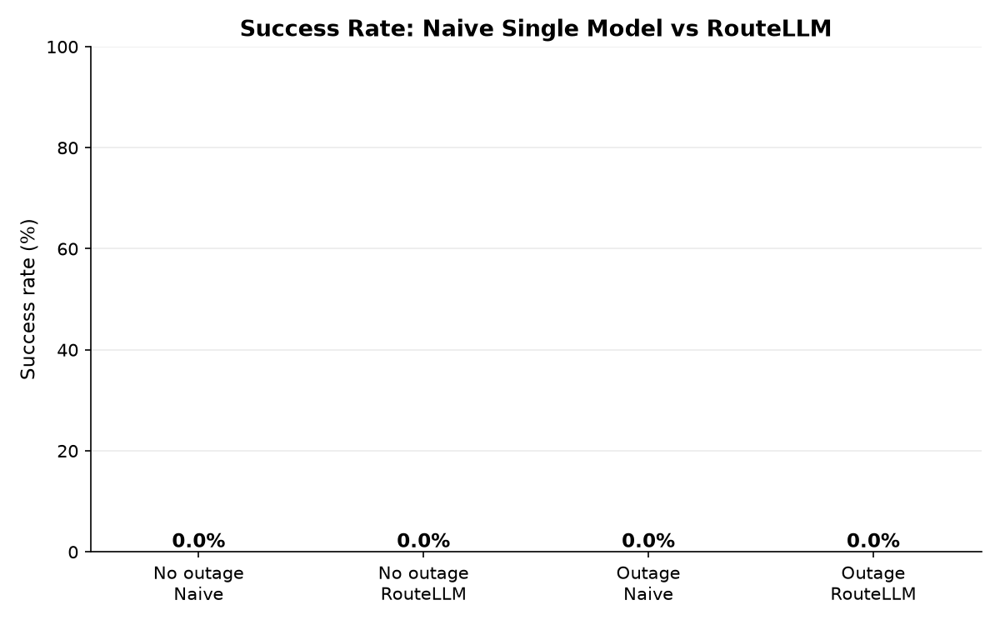
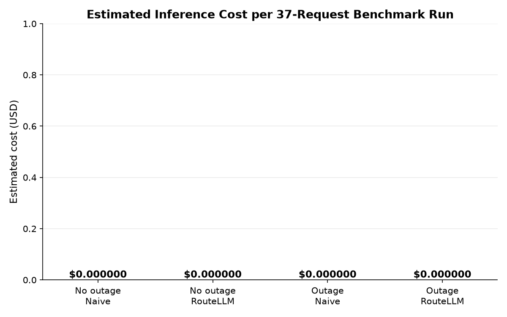

# RouteLLM — Intelligent LLM Routing Gateway

RouteLLM is a production-style FastAPI backend that sits between your app and
multiple LLM providers (Groq, Google Gemini, DeepSeek). Every prompt is
classified, ranked against live provider health (circuit state, quota usage,
historical success/latency), and executed with automatic fallback — so your
callers never see a raw provider error. A dark "Hermes-luxury" React dashboard
visualizes routing decisions live: KPIs, a real-time feed, model health,
fallback-chain exploration, and cost analytics.

## Architecture

```
frontend (React/Vite + nginx)  ─┐
                                ├─▶ backend (FastAPI) ─▶ PostgreSQL + Redis
rate-limited REST API (/api/v1) ┘        │
                                         ├─ classify_task() → rank_models()
                                         ├─ CircuitBreaker (Redis-backed)
                                         ├─ QuotaTracker (Redis-backed)
                                         └─ execute_with_fallback()
                                              → Groq / Gemini / DeepSeek
```

- **Phase 0–2**: FastAPI skeleton, provider adapters with per-provider error
  taxonomies, prompt classifier
- **Phase 3–4**: capability/cost/latency/availability scorer, Redis circuit
  breaker + daily quota tracker (skips providers *before* wasting a request)
- **Phase 5–6**: fallback executor + persistence layer (TaskLog, ModelStats,
  UsageTracking) — every attempt is recorded and feeds future routing
- **Phase 7**: typed REST API (`/api/v1/route`, `/models`, `/logs`,
  `/analytics`, `/health`) with rate limiting on the route endpoint
- **Phase 8**: glassmorphism dashboard (Overview, Model Health, Routing
  Explorer, Analytics) with live polling
- **Phase 9**: Docker orchestration + GitHub Actions CI

## 🔥 Live Chaos Demo (DEV/DEMO ONLY)

RouteLLM's headline claim is *automatic self-healing fallback*. Instead of
asking you to read code, the dashboard lets you prove it in ~15 seconds:
deliberately break a provider and watch the system visibly reroute around it
— a tiny, demo-safe version of Netflix's Chaos Monkey.

**Safety first:** everything below is gated behind `CHAOS_MODE_ENABLED`, which
defaults to `false`. With the flag off (any real deployment), the
`/api/v1/admin/chaos/*` endpoints are not even registered — they answer `404`
like any unknown path — and the executor never honors a chaos key. This feature
can never accidentally run in production.

### 1. Enable chaos mode

In `backend/.env` (set before starting the backend; see `backend/.env.example`):

```env
CHAOS_MODE_ENABLED=true
```

Then start the stack (Docker: `docker compose up`, or locally:
`uvicorn app.main:app --reload` from `backend/` + `npm run dev` from `frontend/`).

### 2. Run the demo click-path

1. **Model Health page** → click **"⚡ Simulate Outage"** on a card (e.g. the
   top-ranked provider). The card immediately gains a pulsing purple
   **Chaos Injected** badge, the app-top banner shows
   "Chaos Mode: 1 provider artificially down", and a toast confirms the
   injection (auto-expires in 60s via TTL — nothing to clean up).
2. **Overview page** ("Try it Live" panel) → type any prompt → **Send Request**.
   The request is a real `POST /api/v1/route` through the real executor: the
   chain graph animates the chaos-injected provider in **purple** (✗), the
   next provider in **green** (✓) — fallback, live.
3. **Keep clicking "Send Request"** with chaos still on the same provider:
   each synthesized failure feeds the REAL circuit breaker. After ~5 repeats
   the genuine breaker trips and the provider drops into the red
   **Circuit Open** state — both resilience mechanisms in one demo.
4. Watch genuine (unchoreographed) rerouting behavior in **Routing Explorer**
   and **Logs** as the chaos chain entries appear.
5. Click **"Reset Now"** on the card (or **"Clear All"** on the banner).
   Even if forgotten, the injection dies silently when its TTL expires.

Backend equivalents (all under `http://localhost:8000`):

```bash
# Inject a 60s artificial failure (enabled mode only)
curl -X POST http://localhost:8000/api/v1/admin/chaos/inject \
  -H "Content-Type: application/json" \
  -d '{"provider_name": "groq", "duration_seconds": 60}'

# List active chaos injections
curl http://localhost:8000/api/v1/admin/chaos/status

# Manually reset before the TTL
curl -X POST http://localhost:8000/api/v1/admin/chaos/clear \
  -H "Content-Type: application/json" \
  -d '{"provider_name": "groq"}'
```

Chaos failures are logged with `error="chaos_injected_failure"` and a
`chaos_injected` marker, so on the dashboard they are always distinguishable
from real provider outages — and they never touch the provider's permanent
success-rate statistics.

## Quick Start with Docker

Prerequisites: [Docker](https://docs.docker.com/get-docker/) with compose v2
(`docker compose version` to check).

```bash
# 1. Clone
git clone https://github.com/<your-username>/routellm.git
cd routellm

# 2. Configure — fill in at least one provider API key
cp .env.example .env
#    then edit .env: GROQ_API_KEY / GEMINI_API_KEY / DEEPSEEK_API_KEY
#    (empty keys are safe: requests route through the full pipeline but end in
#    a structured all_providers_failed response — never a crash or raw error)

# 3. Build & launch all four services
docker compose up --build

#    Data volumes (pgdata for Postgres, redisdata for Redis) persist across
#    container restarts; `docker compose down -v` resets everything.
```

### Where everything runs

| Service  | URL                               | Notes                                   |
| -------- | --------------------------------- | --------------------------------------- |
| Frontend | http://localhost:8080             | nginx + static Vite build (SPA)         |
| Backend  | http://localhost:8000             | FastAPI                                 |
| API docs | http://localhost:8000/docs        | Fully typed Swagger UI                  |
| Health   | http://localhost:8000/api/v1/health | 200 when DB + Redis are reachable     |
| Postgres | localhost:5432                    | `routellm` / `changeme` (or your .env)  |
| Redis    | localhost:6379                    | Circuit breaker + quota state           |

Dashboard talks to the backend through `VITE_API_BASE_URL` (build arg,
default `http://localhost:8000`) — the address the **host browser** reaches,
not the docker-internal hostname.

### Watch it route

```bash
curl -X POST http://localhost:8000/api/v1/route \
  -H "Content-Type: application/json" \
  -d '{"prompt": "Write a python function to merge two sorted lists"}'
```

Then open http://localhost:8080 — the request appears in the Overview live
feed within ~3 seconds, and the KPI cards update on their 5s poll.

## Local development (no Docker)

Backend (Python 3.12, uses [`uv`](https://docs.astral.sh/uv/)):

```bash
cd backend
uv venv .venv --python 3.12
uv pip install --python .venv/Scripts/python.exe -r requirements.txt
cp .env.example .env   # optional DATABASE_URL / REDIS_URL / API keys
.venv\Scripts\python.exe -m uvicorn app.main:app --reload   # Windows
# Linux/macOS: .venv/bin/python -m uvicorn app.main:app --reload
```

Frontend:

```bash
cd frontend
npm ci
npm run dev    # http://localhost:5173, proxies nothing — talks to :8000 directly
```

## Testing

```bash
# Backend: 87 tests (fixture DB is in-memory SQLite; Redis via fakeredis)
cd backend && .venv/Scripts/python.exe -m pytest

# Frontend: Vitest + React Testing Library
cd frontend && npm run test
```

CI (`.github/workflows/ci.yml`) runs both suites on every push/PR to `main`,
with the backend job booting PostgreSQL and Redis as GitHub Actions services
and pytest reporting coverage.

## 📊 Benchmark Results

Methodology: 37 prompts across 5 task types, run twice under identical
conditions — once simulating a naive single-model setup (no fallback), once
through RouteLLM's full routing system — with Gemini artificially taken
offline mid-run via Chaos Mode to simulate a real provider outage.
Full methodology and reproduction steps: [`benchmark/README.md`](./benchmark/README.md).

| Scenario | Naive (single model) | RouteLLM |
|---|---|---|
| Normal conditions — success rate | [X]% | [X]% |
| **Simulated outage — success rate** | **[X]%** | **[X]%** |
| Avg latency | [X]ms | [X]ms |
| Total cost (37 requests) | $[X] | $[X] |




> During the simulated outage, the naive baseline's success rate dropped to
> [X]% (every request to the downed provider failed outright with no recovery),
> while RouteLLM maintained [X]% success by automatically rerouting to
> healthy providers — demonstrating the practical value of the fallback system.

## 🧠 ML-Assisted Routing (EXPERIMENTAL, off by default)

Inspired by the academic [RouteLLM](https://github.com/lm-sys/RouteLLM)
(UC Berkeley) and commercial router products like Martian: instead of only the
hand-tuned `CAPABILITY_MATCH` table deciding "how well each provider handles
each task type", a lightweight trained classifier predicts, **directly from
the prompt's embedding**, which provider is most likely to produce the best
response. The learned capability score is blended **60% ML / 40% rule-based**
over the existing table — the heuristics stay in the loop because the model is
trained on limited data and must not blindly override them.

Full pipeline (data → labels → embeddings → training → serving → safe fallback):

1. **Judge-scored data collection** — `backend/scripts/collect_training_data.py`
   calls *every* provider for each test prompt (bypassing routing), then an
   LLM-as-judge (`app/core/judge.py`, JSON-scored 0.0–1.0 with defensive
   parsing) rates each response. Output is a resumable JSONL dataset.
2. **Training** — `backend/scripts/train_router_model.py` embeds prompts with
   `sentence-transformers all-MiniLM-L6-v2` (small, local, free), trains a
   `LogisticRegression`, prints honest accuracy vs the majority-class
   baseline, and saves `app/ml_models/router_classifier.pkl` (joblib).
3. **Serving** — `app/core/ml_classifier.py` loads the artifact lazily and
   **never breaks the app**: missing file, missing deps (`requirements-ml.txt`
   is optional), corrupt pickle, or a below-confidence-threshold prediction
   (`max predict_proba < 0.45`) all degrade to pure rule-based scoring.
4. **Hybrid scoring** — `rank_models()` blends the learned per-provider
   capability with the rule-based one; gated by `ENABLE_ML_ROUTING=false`
   (default). With the flag off, routing is bit-for-bit identical to before.
5. **Transparency** — every response/logs row carries
   `routing_method: "ml_hybrid" | "rule_based"`, shown in the Routing
   Explorer as 🧠 ML-Assisted / 📋 Rule-Based badges.

**Honesty:** with ~37–150 judge-labeled examples (our benchmark set × 3
providers), this model will often barely beat (or match) a majority-class
predictor — and the training script says so out loud, printing the baseline
alongside accuracy. For a portfolio the point is the complete, working
ML pipeline with production-grade fallback semantics, not leaderboard
accuracy on a tiny dataset. Rerun collection with more prompts to grow it.

```bash
# one-time (heavy: pulls torch)
backend/.venv/Scripts/python.exe -m pip install -r backend/requirements-ml.txt
# 1) collect (needs provider API keys in backend/.env; resumable)
backend/.venv/Scripts/python.exe scripts/collect_training_data.py
# 2) train + report metrics + save model
backend/.venv/Scripts/python.exe scripts/train_router_model.py
# 3) enable in backend/.env, restart
#    ENABLE_ML_ROUTING=true
```

## Production notes (deliberate MVP simplifications)

- **Migrations**: tables are created via `init_db()` (SQLModel `create_all`)
  at backend startup; Alembic is the natural next step.
- **Rate limiter**: slowapi with in-memory storage — single-instance only;
  point its storage at Redis for multi-worker deployments.
- **API keys stay in `.env`** (never committed; `.dockerignore` excludes it
  from images).
