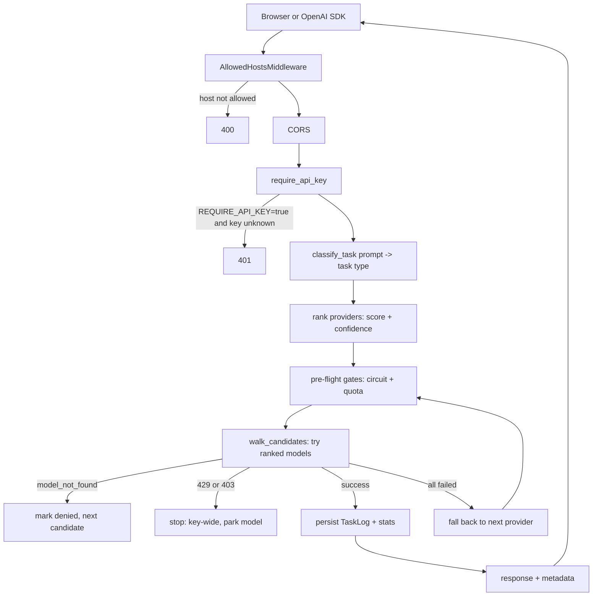
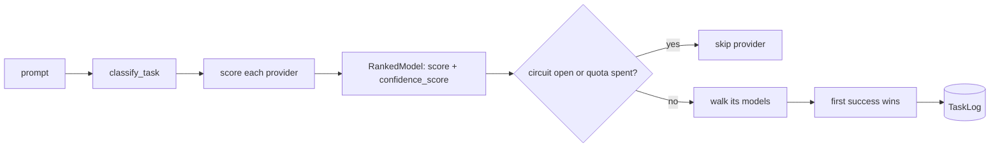
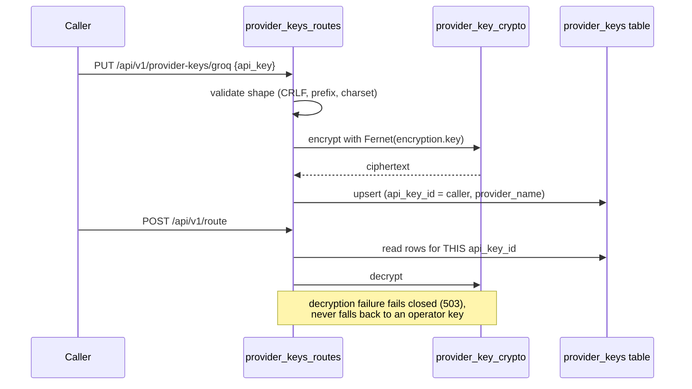
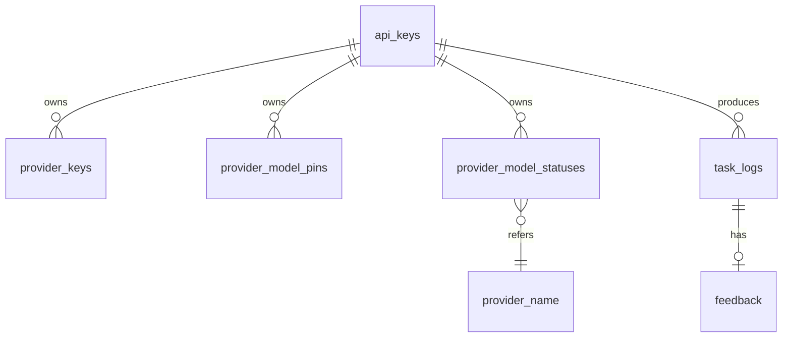
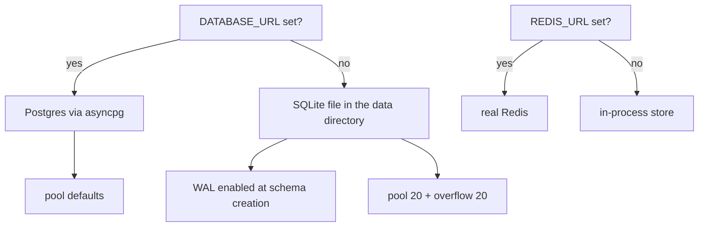

# Architecture

> **How this file is maintained.** Every statement below was read out of the
> code in this repository, not from memory or from the README. Paths are given
> so any claim can be checked. Where a feature is present but not fully
> exercised, it says so — see [Feature inventory](#feature-inventory).

## Stack

Versions are the resolved pins from the lockfiles, read on 2026-11.

| Layer | Component | Version | Source of truth |
|---|---|---|---|
| Runtime | Python | 3.11+ (CI runs 3.11 and 3.12; 3.13 informational) | `.github/workflows/ci.yml` |
| API | FastAPI | 0.162.0 | `backend/requirements.txt` |
| API | Starlette (via FastAPI) | 1.10.0 | resolved |
| API | Uvicorn | 0.54.0 (`[standard]`) | `backend/requirements.txt` |
| Validation | Pydantic | 2.12.5 | `backend/requirements.txt` |
| ORM | SQLModel | 0.0.48 | `backend/requirements.txt` |
| ORM | SQLAlchemy (via SQLModel) | 2.1.9 | resolved |
| DB driver | aiosqlite / asyncpg | 0.22.1 / 0.32.0 | `backend/requirements.txt` |
| Cache | redis (client) | 8.1.0 | `backend/requirements.txt` |
| HTTP | httpx | 0.28.1 | `backend/requirements.txt` |
| Crypto | cryptography (Fernet) | 50.0.2 | `backend/requirements.txt` |
| UI runtime | Node | 24.22.2 | `.github/workflows/ci.yml` |
| UI | React | ^19.3.1 | `frontend/package.json` |
| UI | Vite | ^8.3.4 | `frontend/package.json` |
| UI | TypeScript | ~6.0.3 | `frontend/package.json` |
| UI | Recharts | ^3.10.1 | `frontend/package.json` |
| UI | React Router | ^7.18.4 | `frontend/package.json` |

SQLAlchemy is pinned **transitively** through `sqlmodel==0.0.48`; the app
imports `sqlalchemy` directly (`backend/app/db/session.py`), so the resolved
version matters even though it is not named in a requirements file.

## Request path

The order of `B` before `C` is deliberate: the Host check is registered last so
it runs first, before any CORS handling (`backend/app/main.py:404-408`).

## Routing decision

The router answers one question: *which provider, and which model within it,
should serve this prompt?* It is a ranked pipeline, not a learned end-to-end
model (the optional ML router is a separate, artifact-gated path — see the
inventory).

`confidence_score` is `success_rate * capability_match`
(`backend/app/core/scorer.py:198`) — a ranking score, not a calibrated
probability. It is a *separate* number from the derived task-classification
confidence described in `evals/`, and the UI colours it at 0.7 / 0.4
(`frontend/src/pages/RoutingExplorer.tsx:16-20`). **OBSERVED**: real routing
through local stub upstreams produced 0.375, 0.675 and 0.9, so all three colour
branches are reachable — the thresholds are not dead bands.

## Provider key storage (BYOK)

Two facts worth knowing before debugging a key problem:

* Rows are scoped to the Routtener key that saved them
  (`backend/app/core/provider_key_manager.py`). A freshly minted key owns no
  provider keys — the usual cause of `configured: none` in an eval run.
* The database stores only ciphertext and a `****last4` hint. The raw demo key
  lives in the browser's `localStorage` (`frontend/src/api/keyStorage.ts`) so a
  returning visitor can reuse it; the backend keeps only a SHA-256 hash.

If `data/encryption.key` is deleted while rows exist, the app **cannot** decrypt
them. It answers 503 with an operator-facing message on every key path and logs
`encryption_key_missing_but_ciphertext_exists` at warning level rather than
silently minting a replacement key.

## Data model

Table names are a protected contract (`routellm.db`, the `api_keys` /
`provider_keys` / `task_logs` names, the `rk_` key prefix). Nothing in this
document proposes changing them.

## Storage modes

SQLite is the local default and gets an explicit pool size and WAL because the
concurrent walk path exhausts a default 5+10 pool (OBSERVED: 30 concurrent
requests, 91 s and 15 × 503 before the fix; 1.5 s and 30/30 after). The
regression test is `backend/tests/integration/test_concurrent_walk_pool.py`.

## Feature inventory

Statuses are honest, not aspirational. "IMPLEMENTED + TESTED" means there is an
automated test that fails when the behaviour is broken — several were verified
by mutation (break the code, watch the test fail, restore).

| Feature | Status | Where | Evidence |
|---|---|---|---|
| Task classification (rule-based) | IMPLEMENTED + TESTED | `backend/app/core/classifier.py` | unit tests + `evals/run_routing_eval.py` (91.0% on its own labelled set) |
| Provider ranking + confidence | IMPLEMENTED + TESTED | `backend/app/core/scorer.py` | unit tests; colour reachability observed live |
| Per-request provider fallback | IMPLEMENTED + TESTED | `backend/app/core/executor.py` | integration tests; resilience eval |
| Model walking (retired-model recovery) | IMPLEMENTED + TESTED | `backend/app/core/model_discovery.py` | unit + integration; mutation-caught |
| Circuit breaker | IMPLEMENTED + TESTED | `backend/app/core/circuit_breaker.py` | 45 test references |
| Quota tracking | IMPLEMENTED + TESTED | `backend/app/core/quota_tracker.py` | 47 references; exhaustion pinned |
| BYOK provider keys (Fernet) | IMPLEMENTED + TESTED | `backend/app/core/provider_key_crypto.py` | 10 references; loss path tested |
| Key-scoped provider isolation | IMPLEMENTED + TESTED | `backend/app/core/provider_key_manager.py` | isolation tests |
| OpenAI-compatible endpoint | IMPLEMENTED + TESTED | `backend/app/api/openai_compat_routes.py` | real `openai` client against the demo provider |
| Diagnostics report (scrubbed) | IMPLEMENTED + TESTED | `backend/app/api/provider_keys_routes.py:605-702` | 6 endpoint tests |
| Pinned model | IMPLEMENTED + TESTED | `backend/app/api/provider_keys_routes.py:447` | 40 references |
| Chaos mode (inject failures) | IMPLEMENTED + TESTED | `backend/app/core/chaos.py` | gated on `CHAOS_MODE_ENABLED`; provider-not-called pinned |
| Demo provider | IMPLEMENTED + TESTED | `backend/app/providers/demo_provider.py` | intentionally NOT advertised in `/v1/models` |
| Local launcher (`run.py`) | IMPLEMENTED + TESTED | `run.py` | 47 launcher tests |
| Eval suite (mocked) | IMPLEMENTED + TESTED | `evals/` | Wilson intervals verified (20/20 → 83.9%, 50/50 → 92.9%) |
| Eval suite (live) | IMPLEMENTED, NOT TESTED HERE | `evals/run_resilience_eval.py` | requires real keys; the owner must run it (see the README) |
| ML hybrid router | PARTIAL-STUB | `backend/app/core/ml_classifier.py` | no `router_classifier.pkl` in the repo; `ENABLE_ML_ROUTING` without the artifact behaves exactly as rule-based |
| LLM judge (data collection) | IMPLEMENTED, NOT IN THE REQUEST PATH | `backend/app/core/judge.py` | only `backend/scripts/collect_training_data.py` calls it |
| `mask_secrets()` helper | DOCUMENTED ONLY | `backend/app/utils/masking.py` | no caller, no test; the live masking is in `outcomes.redact`, `_scrub`, `mask_database_url` |
| Cloudflare / managed deployment | DOCUMENTED ONLY | `docs/deploy/` (archived) | not exercised by this repository's CI |

## What this document does not claim

* No latency, accuracy or cost number here is a benchmark. The eval document
  (`docs/eval-results.md`) is the only place real measurements belong, and a
  live run is the only way to produce one.
* The ML router is not described as "active". Without the artifact it is not.
* `masking.py` is not described as a protection. It is a helper nobody calls.
