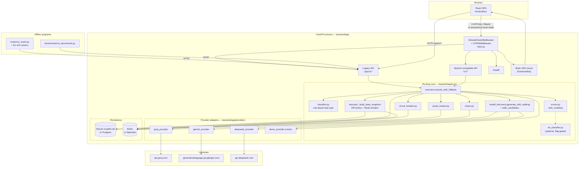
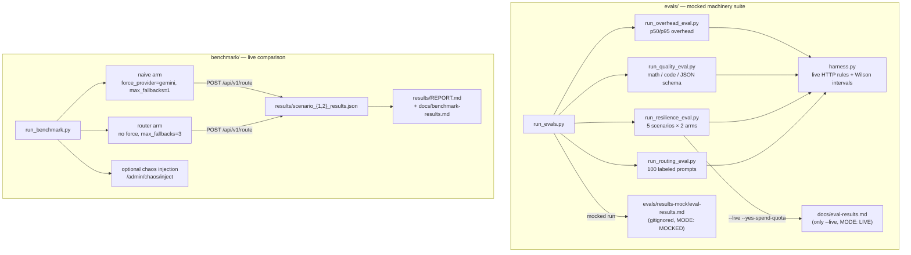

# Routtener — architecture

This document explains how the project works end to end. It is written from
the source at the commit on branch `audit/architecture-and-dead-code`
(descended from `origin/main` at `fd4f36e`).

**Evidence labels.** Every factual statement below is tagged:

- **OBSERVED** — read directly in the repository at the cited path (or produced
  by a command run on this machine).
- **DOCUMENTED** — stated by a file the project itself ships (README, docs/,
  docstrings), not independently re-verified.
- **ASSUMED** — an inference. Never presented as verified behaviour.

The label describes *how we know*, not how confident we are. A code path that
is present but that no test or live run exercises is still OBSERVED code and
ASSUMED behaviour.

---

## 1. Tech stack

Versions are exact pins where the repository pins them; ranges are shown with
the resolved lockfile version in brackets. Source of truth:
`backend/requirements.txt`, `backend/requirements-dev.txt`,
`frontend/package.json`, `frontend/package-lock.json`, `.github/workflows/ci.yml`.

| Layer | Technology (version) | Where | Evidence |
|---|---|---|---|
| Language (backend) | Python 3.11+ (CI: 3.11, 3.12; 3.13 informational; local venv: 3.12.14) | `backend/`, `run.py`, `pytest.ini` | OBSERVED |
| HTTP framework | FastAPI 0.162.0 | `backend/app/main.py` | OBSERVED |
| ASGI server | uvicorn[standard] 0.54.0 | `backend/requirements.txt` | OBSERVED |
| Settings | pydantic 2.12.5, pydantic-settings 2.16.2 | `backend/app/config.py` | OBSERVED |
| HTTP client | httpx 0.28.1 | `backend/app/providers/*` | OBSERVED |
| BYOK crypto | cryptography 50.0.2 (Fernet) | `backend/app/core/provider_key_crypto.py` | OBSERVED |
| ORM / DB | SQLModel 0.0.48 on SQLAlchemy 2.x; aiosqlite 0.22.1 (default), asyncpg 0.32.0 (Postgres), greenlet 3.5.6 | `backend/app/db/`, `backend/app/models/` | OBSERVED |
| Cache / breaker / quota | redis 8.1.0; fakeredis 2.40.0 fallback | `backend/app/cache.py`, `core/circuit_breaker.py`, `core/quota_tracker.py`, `core/chaos.py` | OBSERVED |
| Logging | structlog 26.1.0 | `backend/app/utils/logger.py` | OBSERVED |
| Rate limiting | slowapi 0.1.10 | `backend/app/api/routes.py` | OBSERVED |
| Backend tests | pytest 9.2.0, pytest-asyncio 1.4.1.post1, pytest-cov 7.1.0, respx 0.23.1, joblib >=1.3, openai 3.42.1 | `backend/requirements-dev.txt` | OBSERVED |
| Frontend framework | React 19.3.1, React DOM 19.3.1 | `frontend/package-lock.json` | OBSERVED |
| Frontend routing | react-router-dom 7.18.4 | `frontend/src/App.tsx` | OBSERVED |
| Frontend state | Zustand 5.0.16 | `frontend/src/store/useAppStore.ts` | OBSERVED |
| Frontend HTTP | axios 1.20.0 | `frontend/src/api/client.ts` | OBSERVED |
| Charts | Recharts 3.10.1 | `frontend/src/pages/Analytics.tsx`, `components/*` | OBSERVED |
| Animation | framer-motion 14.6.0 | `frontend/src/components/` | OBSERVED |
| Icons | lucide-react 1.61.x | `frontend/src/components/navigation.ts` | OBSERVED |
| Styling | Tailwind CSS 3.4.19, PostCSS 8.5.31, Autoprefixer 10.6.1 | `frontend/tailwind.config.js`, `postcss.config.js` | OBSERVED |
| Build tool | Vite 8.3.5 | `frontend/vite.config.ts` | OBSERVED |
| Type system | TypeScript 6.0.3 | `frontend/tsconfig*.json` | OBSERVED |
| Frontend tests | Vitest 5.0.5, jsdom 30.1.3, Testing Library (react 16.3.3, jest-dom 7.0.1, user-event 14.6.8) | `frontend/vite.config.ts`, `src/setupTests.ts` | OBSERVED |
| Lint | oxlint 1.89.0 | `frontend/package.json` | OBSERVED |
| CI runtime (frontend) | Node 24.22.2 | `.github/workflows/ci.yml` | OBSERVED |
| CI database/services | Postgres 16-alpine, Redis 7-alpine | `.github/workflows/ci.yml` | OBSERVED |
| Container | Docker + docker-compose, one backend service | `backend/Dockerfile`, `docker-compose.yml` | OBSERVED |
| Optional ML | scikit-learn / joblib model (`backend/app/ml_models/router_classifier.pkl`), `requirements-ml.txt` | `backend/app/core/ml_classifier.py` | OBSERVED (code), ASSUMED (model file present in a given checkout) |

---

## 2. System architecture

The repository is one FastAPI process that optionally serves the built React
dashboard, plus two standalone Python programs (`evals/`, `benchmark/`) that
talk to a running backend over HTTP.



**Component responsibilities (OBSERVED):**

| Component | Path | Responsibility |
|---|---|---|
| App factory | `backend/app/main.py` | Creates `FastAPI`, registers middleware/routers/health, mounts the SPA last, installs exception handlers for DB outages |
| Auth dependency | `backend/app/api/dependencies.py` | Resolves `X-API-Key` or `Authorization: Bearer`; local anonymous identity when `REQUIRE_API_KEY=false`; decrypts BYOK keys and pins per request |
| Legacy API | `backend/app/api/routes.py` | `POST /route`, `GET /models`, `/logs`, `/analytics`, `/feedback`, `/feedback/summary`, `/health` |
| OpenAI adapter | `backend/app/api/openai_compat_routes.py` | `POST /v1/chat/completions`, `GET /v1/models`; OpenAI error envelope; dual routing metadata |
| Keys API | `backend/app/api/keys_routes.py` | `POST /keys/generate` (201), `GET/DELETE /keys/me` |
| Provider keys API | `backend/app/api/provider_keys_routes.py` | BYOK CRUD, model explorer, per-model test, pinning, diagnostics |
| Provider test | `backend/app/api/provider_test_routes.py` | `POST /provider-test/{provider}` — Auto "Test connection" through the real walk |
| Catalog | `backend/app/api/catalog_routes.py` | `GET /catalog` — static editorial data merged with live stats |
| Setup | `backend/app/api/setup_routes.py` | `GET /setup/status` — first-run/demo guidance, no secrets |
| Chaos admin | `backend/app/api/chaos_routes.py` | Inject/clear simulated provider outages (404 when disabled) |
| Classifier | `backend/app/core/classifier.py` | Pure keyword/regex classification into `code`, `reasoning`, `summarization`, `qa`, `general` |
| Scorer | `backend/app/core/scorer.py` | Pure weighted ranking: capability, success rate, cost, latency, availability; OPEN circuits sort last |
| Executor | `backend/app/core/executor.py` | The routing brain: snapshot → rank → gate → attempt → telemetry → persist → fall through |
| Model discovery | `backend/app/core/model_discovery.py` | Discovery adapter, candidate ranking, per-key statuses, replacement-id extraction, candidate walk |
| Model registry | `backend/app/providers/model_registry.py` | The single discovery engine: fetch, cache, DB row, allow-list, ranking |
| Breaker | `backend/app/core/circuit_breaker.py` | Redis-backed CLOSED/OPEN/HALF_OPEN per provider |
| Quota | `backend/app/core/quota_tracker.py` | Redis-backed daily request/token counters and limits |
| Chaos | `backend/app/core/chaos.py` | Redis-backed fault injection, inert unless enabled |
| Test guard | `backend/app/core/test_endpoint_guard.py` | Per-key concurrency/rate guard for live test/diagnostic calls |
| BYOK manager | `backend/app/core/provider_key_manager.py` | Encrypt/decrypt/store/list/delete caller-scoped provider keys |
| BYOK crypto | `backend/app/core/provider_key_crypto.py` | Fernet encryption, hint extraction, fail-closed errors |
| Error messages | `backend/app/core/error_messages.py` | Maps raw provider error codes to human diagnostics at the API edge |

---

## 3. Routed-chat request flow

This is the path for `POST /api/v1/route` and `POST /v1/chat/completions`
(model `routtener-auto` / `routellm-auto`). A request that names a provider
(`"model": "groq"` or `force_provider`) takes the forced single-provider branch
instead of ranking.

```mermaid
sequenceDiagram
    autonumber
    participant C as Client
    participant MW as AllowedHosts + CORS
    participant R as Route handler
    participant A as require_api_key
    participant P as require_provider_api_keys / pins
    participant E as execute_with_fallback
    participant CL as classify_task
    participant S as _build_stats_snapshot
    participant SC as rank_models
    participant G as Quota + breaker + chaos gates
    participant W as generate_with_walking
    participant PR as Provider adapter
    participant DB as Database
    participant RD as Redis

    C->>MW: POST /api/v1/route or /v1/chat/completions
    MW->>MW: Host allow-list (400 if rejected)
    MW->>R: forward
    R->>A: resolve identity
    A->>DB: validate hash / load local identity
    A-->>R: ApiKeyDB (401 if REQUIRE_API_KEY and invalid)
    R->>P: decrypt BYOK keys + pinned models
    P-->>R: {provider: key}, {provider: model}
    R->>E: prompt, task_type?, force_provider?, temperature, max_tokens
    alt force_provider is set
        E->>PR: one provider, zero fallback (chaos + BYOK gate still apply)
        PR-->>E: ProviderResponse
    else automatic routing
        E->>CL: classify if task_type omitted
        CL-->>E: code | reasoning | summarization | qa | general
        E->>S: snapshot stats for task_type
        S->>DB: ModelStats + Feedback aggregates
        S->>RD: circuit state per provider
        S-->>E: dict[provider, ModelStats]
        E->>SC: rank_models(task_type, routable providers, stats)
        SC-->>E: ranked providers + confidence_score
        loop ranked providers until success or max_fallbacks real attempts
            E->>G: quota within limit?
            alt quota exceeded
                G-->>E: skip (logged, does not consume budget)
            else
                E->>G: circuit OPEN?
                alt OPEN
                    G-->>E: skip (logged, does not consume budget)
                else
                    E->>G: chaos active for provider?
                    alt chaos active
                        G-->>E: synthesized failure (counts as attempt)
                    else
                        E->>W: attempt with caller/operator key + pin
                        W->>PR: initial model (pin → env override → warm cache → default)
                        alt success
                            PR-->>W: text + tokens + latency
                        else model_not_found or 403
                            W->>W: discover models, rank candidates, walk ≤3
                            W->>PR: next candidates (replacement hint first)
                        else 429 / other
                            W-->>E: stop; let provider fallback take over
                        end
                        PR-->>W: ProviderResponse
                        W-->>E: response + walk steps + initial model
                    end
                    E->>RD: record breaker success/failure (policy below)
                    E->>RD: record quota usage (real calls only)
                    E->>DB: TaskLog + ModelStats + UsageTracking (once, on return)
                    alt response.success
                        E-->>R: ExecutionResult(success)
                    end
                end
            end
        end
        E-->>R: ExecutionResult(all_providers_failed) if none succeeded
    end
    R->>DB: record_api_key_usage on success
    R-->>C: legacy RouteResponse or OpenAI chat.completion (+ dual metadata)
```

### 3.1 Authentication

OBSERVED in `backend/app/api/dependencies.py`:

- `REQUIRE_API_KEY=true`: `X-API-Key` must hash to an active row; missing,
  unknown and revoked keys are `401` with `WWW-Authenticate: ApiKey`.
- `REQUIRE_API_KEY=false` (default): no header needed; the request is
  attributed to a stable local identity row so usage counters and BYOK storage
  keep working. A presented key is still validated; a stale one is ignored
  with a log line.
- `Authorization: Bearer <key>` is accepted for OpenAI SDK clients.
- BYOK decryption failures fail **closed** with `503`, never silently falling
  back to operator keys.

### 3.2 Classification

OBSERVED in `backend/app/core/classifier.py`: pure, microsecond-scale
keyword/regex rules. Priority order is code > reasoning > summarization > qa >
general. Long prompts (>1500 chars) classify as `summarization`. A caller may
override `task_type`; the OpenAI adapter also accepts it.

### 3.3 Confidence and selection

OBSERVED in `backend/app/core/scorer.py`:

- Score = `0.35·capability + 0.30·success_rate + 0.15·cost + 0.10·latency +
  0.10·availability` (defaults; callers may override weights).
- `capability` comes from the static `CAPABILITY_MATCH` table; unknown
  provider/task pairs get `0.3`.
- `success_rate` is `feedback_adjusted_success_rate`: raw API success, blended
  with thumbs up/down using a weight capped at 0.5.
- New providers with no history use an optimistic `0.75`.
- `confidence_score = round(success_rate × capability_match, 3)`.
- Providers with an **OPEN** circuit always sort last, regardless of score.
- Optional ML: when `ENABLE_ML_ROUTING=true`, a model is loaded, and the
  classifier is confident, capability is blended 60% ML / 40% rules. Otherwise
  scoring is bit-for-bit rule-based (DOCUMENTED in the docstring and covered by
  `tests/unit/test_scorer.py`).

### 3.4 Pre-flight gates and fallback budget

OBSERVED in `backend/app/core/executor.py`:

1. **Quota gate** — `quota.is_within_quota(provider)`; a skip is logged with
   `quota_exceeded` and does **not** consume the fallback budget.
2. **Circuit gate** — `circuit.get_state(provider) == "OPEN"`; a skip is logged
   with `circuit_open` and does **not** consume the budget.
3. **Chaos gate** (DEV/DEMO) — when enabled and active, a synthesized
   `chaos_injected_failure` flows through the normal attempt/telemetry path.
   It **does** consume the budget but never writes permanent stats/quota.

`max_fallbacks` (default 3, coerced to at least 1) counts **real provider
calls**, not skips. On success the chain and result are persisted once; on
exhaustion the result is `all_providers_failed`.

### 3.5 Circuit-breaker policy after an attempt

OBSERVED in `executor.py`:

| Outcome | Breaker action | Reason |
|---|---|---|
| Success | `record_success` | Normal |
| `bad_request` / `model_not_found` / `endpoint_not_found` / `not_found` | `record_success` | The provider answered; this is our config/model error, not an outage |
| `auth_failed` from a **caller BYOK** key | No breaker change | The caller's credential is their problem; never lock out everyone |
| Chaos-injected failure | `record_failure` | Repeated injections should be able to trip the real breaker |
| Any other failure | `record_failure` | Real outage/timeout |

Quota usage is recorded for real calls (successful or failed), not for chaos
or skips.

### 3.6 Candidate walking (retired-model resilience)

OBSERVED in `backend/app/core/model_discovery.py`:

- First attempt keeps legacy behaviour: pinned model → `.env` override → warm
  cache top → provider default. No discovery on the hot path.
- Only `model_not_found` (404/400 model-missing) triggers discovery and a walk
  of up to `MAX_CANDIDATE_ATTEMPTS = 3`.
- A denied model is remembered per `(key, provider, model)` for 24 h; a 429 is
  parked until `Retry-After` (fallback 60 s); "works" lasts ~1 h. DB rows make
  this survive restarts.
- A replacement id named in the provider error (`use models/X`) is
  strict-regex extracted, verified against the discovered list **and** the Auto
  allow-list, then tried first.
- A 403 triggers **one** cross-family probe, then stops; it is never cached as
  model-denied. A 429 stops the walk immediately. Any other error stops the
  walk and the executor's provider fallback takes over.

### 3.7 Failure routing at the API edge

OBSERVED in `backend/app/api/routes.py`, `openai_compat_routes.py`,
`core/error_messages.py`:

- The legacy route returns a `RouteResponse` with `success=false`, a
  human-readable `error`, and the full attempt chain (raw codes are kept in the
  DB; the response is translated for the dashboard).
- The OpenAI adapter returns HTTP `502` with an OpenAI error envelope; a named
  provider never falls back to another provider.
- Unknown `force_provider` is `400`; `mock` while demo mode is off is a `200`
  envelope with a `demo_disabled` message (so the UI can explain the fix).
- Streaming is rejected with `400` / `streaming_not_supported`.

---

## 4. Provider-key (BYOK) lifecycle

```mermaid
sequenceDiagram
    autonumber
    participant U as Dashboard (Providers page)
    participant API as /api/v1/provider-keys
    participant M as provider_key_manager
    participant CR as provider_key_crypto (Fernet)
    participant DB as provider_keys table
    participant D as model_discovery / model_catalog
    participant R as Routing executor

    U->>API: PUT /provider-keys/{provider} {api_key}
    API->>API: validate provider + length 8..512
    API->>M: upsert_provider_key(api_key_id, provider, raw)
    M->>CR: encrypt_provider_key(raw)
    CR-->>M: Fernet ciphertext
    M->>CR: provider_key_hint(raw)
    CR-->>M: 4-char hint
    M->>DB: insert/update (api_key_id, provider) — ciphertext + hint only
    M-->>API: row (no secret)
    API->>D: fire-and-forget warm discovery (10 s timeout, errors swallowed)
    API-->>U: status: configured, hint, timestamps

    U->>API: GET /provider-keys
    API->>M: list_provider_keys(api_key_id)
    M->>DB: metadata rows
    API-->>U: one status per registered provider (never a key)

    Note over U,R: On every routed request
    R->>M: get_decrypted_provider_keys(api_key_id)
    M->>DB: encrypted rows
    M->>CR: decrypt_provider_key(ciphertext)
    alt decryption fails
        CR-->>R: ProviderKeyEncryptionError → 503 (fail closed)
    else ok
        CR-->>R: {provider: raw key} for this request only
    end
    R->>R: restrict routing to configured providers; pass key as provider_api_key

    U->>API: DELETE /provider-keys/{provider}
    API->>DB: delete provider key row
    API->>DB: delete model pin + per-model statuses for that (key, provider)
    API-->>U: {status: deleted}
```

OBSERVED details:

- Encryption key resolution lives in `backend/app/core/provider_key_crypto.py`
  and `backend/app/local.py`: `PROVIDER_KEY_ENCRYPTION_KEY` if set, otherwise a
  generated `encryption.key` under the data directory. Deleting that file makes
  existing ciphertext unreadable (DOCUMENTED in README).
- The demo provider (`mock`) has no key and is excluded from
  `SUPPORTED_PROVIDERS`.
- `GET` returns `configured`, a 4-character `key_hint`, and timestamps — never
  the key.
- BYOK callers may only route to providers they configured; a forced provider
  without a caller key fails structurally without an upstream call. The demo
  provider is the deliberate exception.
- Model pins (`provider_model_pins`) and per-model statuses
  (`provider_model_statuses`) are caller-scoped and deleted with the key.
- Model Explorer: `GET /{provider}/models`, `POST /{provider}/models/{id}/test`,
  `PUT /{provider}/model`; diagnostics: `POST /{provider}/diagnostics`
  (one list call + up to five one-token probes, redacted end to end).
- All live test/probe calls share `test_endpoint_guard` (10/min per key, max 5
  in flight).

---

## 5. Eval and benchmark flow

Two offline programs exercise a **running** backend. They never ship numbers;
they produce a report from the machine that runs them.



OBSERVED:

- **Mocked eval contract**: `evals/run_evals.py` uses deterministic scripted
  providers, no network and no keys. It writes only
  `evals/results-mock/eval-results.md` under a `MODE: MOCKED` header. Only
  `run_resilience_eval.py --live --yes-spend-quota` writes
  `docs/eval-results.md`, with a `MODE: LIVE` header. This is pinned by
  `backend/tests/test_evals.py`.
- **Resilience live preconditions** (DOCUMENTED in README and code): at least
  two saved provider keys, `CHAOS_MODE_ENABLED`, and the explicit spend flag.
- **Benchmark**: both arms send real `POST /api/v1/route` requests to an
  already-running backend, then a report generator writes Markdown. Chaos mode
  is injected for the chaos scenario and cleared afterwards. HTTP 429 aborts
  the run rather than publish poisoned data. No numbers ship in the repo.
- **Quality eval** checks exact-match math, unit-tested code and JSON schema —
  no LLM judge in the shipped path (`core/judge.py` exists; OBSERVED, its live
  use is not part of the default eval run).

---

## 6. Data model

OBSERVED in `backend/app/models/*.py`. Table names are **PROTECTED contracts**
(the dead-code audit must not rename or drop them).

| Table | Model file | Purpose |
|---|---|---|
| `api_keys` | `api_key.py` | Routtener `rk_…` keys (hash only), usage counters, local identity |
| `provider_keys` | `provider_key.py` | Fernet ciphertext + 4-char hint per `(api_key_id, provider)` |
| `provider_model_pins` | `provider_model_status.py` | Caller-pinned model per provider |
| `provider_model_statuses` | `provider_model_status.py` | Per-model `works` / `denied` / `rate_limited` + last error |
| `discovered_models` | `model_cache.py` | Durable discovery cache per provider/key |
| `model_stats` | `model_stats.py` | Per `(provider, task_type)` request/success/latency history |
| `usage_tracking` | `usage_tracking.py` | Per `(provider, date)` requests/tokens |
| `task_logs` | `task_log.py` | One row per routed request: task type, model, confidence, latency, tokens, error, full fallback chain, routing method |
| `feedback` | `feedback.py` | Thumbs up/down tied to a `request_id` |
| `models` | `model_config.py` | Legacy/static model configuration table — see the audit's dead-code log for status |

SQLite path: `<data dir>/routellm.db` (filename is a **PROTECTED** rename
compatibility surface). The data dir is `ROUTTENER_DATA_DIR` (legacy
`ROUTELLM_DATA_DIR` accepted; new wins), defaulting to `./data`.

---

## 7. Configuration and compatibility contracts

OBSERVED in `backend/app/config.py`, `backend/app/env_compat.py`,
`backend/app/api/openai_compat_routes.py`, README.

**PROTECTED compatibility surfaces** (must keep working; the audit does not
remove them):

- Environment prefix: `ROUTTENER_*` is primary; `ROUTELLM_*` remains a
  documented fallback and the **new** name wins when both are set. Implemented
  in `config.Settings._accept_routtener_prefix` + `app/env_compat.py`; pinned by
  `tests/integration/test_rename_compat.py`.
- API-key prefix `rk_`.
- OpenAI model ids: `routtener-auto` primary, `routellm-auto` accepted alias.
- Response metadata: `x_routtener_metadata` **and** `x_routellm_metadata`, the
  same object under both names.
- Data filenames: `routellm.db`, `encryption.key`.
- Database table names (section 6).
- Browser `localStorage` keys used by the dashboard.
- Demo model id `routtener-demo` is a label only and is **not** advertised in
  `GET /v1/models`.

Notable settings (OBSERVED defaults): `REQUIRE_API_KEY=false`,
`SERVE_FRONTEND=true`, `CHAOS_MODE_ENABLED=true` locally (off by default on
Hugging Face via `chaos_mode_enabled()`), `DEMO_MODE_ENABLED=true`,
`ENABLE_ML_ROUTING=false`, `ROUTE_RATE_LIMIT=30/minute`,
`ALLOWED_HOSTS` empty (loopback + `HOST` always accepted).

---

## 8. Feature inventory

Status vocabulary:

- **IMPLEMENTED + TESTED** — code exists and a named automated test exercises it.
- **IMPLEMENTED, NOT TESTED** — code exists; no automated test was found.
- **PARTIAL** — some of the described behaviour exists; a stated part does not.
- **STUB** — an explicit placeholder that refuses or does nothing.
- **DOCUMENTED ONLY** — described in docs/README, no implementing code found.

| # | Feature | Status | Evidence (test or path) |
|---|---|---|---|
| 1 | Rule-based task classification (code/reasoning/summarization/qa/general) | IMPLEMENTED + TESTED | `backend/tests/unit/test_classifier.py` |
| 2 | Weighted provider scoring + confidence | IMPLEMENTED + TESTED | `backend/tests/unit/test_scorer.py`; `core/scorer.py` |
| 3 | Automatic cross-provider fallback + attempt chain | IMPLEMENTED + TESTED | `backend/tests/integration/test_fallback_flow.py`; `unit/test_executor.py` |
| 4 | Per-provider circuit breaker (CLOSED/OPEN/HALF_OPEN) | IMPLEMENTED + TESTED | `backend/tests/unit/test_circuit_breaker.py`; `integration/test_breaker_policy.py` |
| 5 | Quota pre-flight gate | IMPLEMENTED + TESTED | `backend/tests/unit/test_quota_tracker.py`; `integration/test_fallback_flow.py::test_quota_exceeded_provider_skipped_without_call` |
| 6 | Chaos Mode (inject/clear outages; admin routes 404 when off) | IMPLEMENTED + TESTED | `backend/tests/unit/test_chaos.py`; `integration/test_chaos_executor.py` |
| 7 | Model discovery + candidate walking (retired-model recovery) | IMPLEMENTED + TESTED | `backend/tests/unit/test_model_discovery.py`; `integration/test_walk_policy.py`; `integration/test_model_explorer.py` |
| 8 | Replacement-id extraction from provider errors | IMPLEMENTED + TESTED | `backend/tests/unit/test_model_discovery.py` |
| 9 | Model Explorer (list, per-model test, pin, refresh, statuses) | IMPLEMENTED + TESTED | `backend/tests/integration/test_provider_keys_endpoints.py`; `test_model_explorer.py`; frontend `ModelExplorerPanel.test.tsx` |
| 10 | In-app provider diagnostics + redacted Markdown report | IMPLEMENTED + TESTED | `backend/tests/integration/test_provider_diagnostics.py` |
| 11 | BYOK provider keys encrypted at rest, per caller, never echoed | IMPLEMENTED + TESTED | `backend/tests/integration/test_provider_keys.py`; `unit/test_provider_key_crypto.py` |
| 12 | BYOK isolation (route only to configured providers) | IMPLEMENTED + TESTED | `backend/tests/integration/test_provider_keys.py::test_route_uses_callers_provider_key_and_restricts_fallback` |
| 13 | OpenAI-compatible `/v1/chat/completions` | IMPLEMENTED + TESTED | `backend/tests/integration/test_openai_compat.py` |
| 14 | OpenAI-compatible `/v1/models` (demo not advertised) | IMPLEMENTED + TESTED | `backend/tests/integration/test_openai_compat.py::test_model_list_matches_openai_sdk_and_tracks_registry`; `test_demo_mode.py::test_openai_model_list_does_not_advertise_the_demo_model` |
| 15 | OpenAI error envelope + validation translation | IMPLEMENTED + TESTED | `backend/tests/integration/test_openai_compat.py` |
| 16 | Dual routing metadata (`x_routtener_metadata` + `x_routellm_metadata`) | IMPLEMENTED + TESTED | `backend/tests/integration/test_rename_compat.py`; `test_openai_compat.py` |
| 17 | API key management (`rk_…`, 201 create, usage, revoke) | IMPLEMENTED + TESTED | `backend/tests/integration/test_api_keys.py`; frontend `pages/ApiKeys.test.tsx` |
| 18 | Legacy `/api/v1/route` with full routing metadata | IMPLEMENTED + TESTED | `backend/tests/integration/test_routes.py`; `test_fallback_flow.py` |
| 19 | Live provider health `/api/v1/models` | IMPLEMENTED + TESTED | `backend/tests/integration/test_routes.py`; frontend `ModelHealth` page |
| 20 | Logs / analytics / cost estimates | IMPLEMENTED + TESTED | `backend/tests/integration/test_routes.py`; frontend `Analytics` page |
| 21 | Feedback (thumbs up/down) + summary | IMPLEMENTED + TESTED | `backend/tests/integration/test_feedback.py` |
| 22 | Static + live catalog | IMPLEMENTED + TESTED | `backend/tests/integration/test_catalog.py`; frontend `pages/ModelCatalog.test.tsx` |
| 23 | Demo/mock provider (labelled, no network, never auto-routed) | IMPLEMENTED + TESTED | `backend/tests/integration/test_demo_mode.py`; `test_forced_mock_demo.py` |
| 24 | Demo traffic excluded from reports/benchmarks | IMPLEMENTED + TESTED | `backend/tests/integration/test_demo_mode.py::test_surfaces_report_real_vendors_only`; `test_benchmark.py` |
| 25 | Host-header allow-list (DNS-rebinding defence, Codespaces) | IMPLEMENTED + TESTED | `backend/tests/unit/test_allowed_hosts_middleware.py` |
| 26 | CORS allow-list + fail-soft startup | IMPLEMENTED + TESTED | `backend/tests/integration/test_cors_and_failsoft.py` |
| 27 | SQLite default / Postgres optional | IMPLEMENTED + TESTED | `backend/tests/integration/conftest.py`; `test_deployment_resilience.py` |
| 28 | Redis optional / fakeredis fallback, one contract for both | IMPLEMENTED + TESTED | `backend/tests/integration/test_redis_contract.py` |
| 29 | Rename compatibility (`ROUTTENER_*`/`ROUTELLM_*`, model alias, metadata) | IMPLEMENTED + TESTED | `backend/tests/integration/test_rename_compat.py` |
| 30 | SPA served from the backend, stale-build banner | IMPLEMENTED + TESTED | `backend/tests/integration/test_frontend_serving.py`; frontend `BuildVersion.test.tsx` |
| 31 | First-run onboarding checklist / demo card / no-key banner | IMPLEMENTED + TESTED | frontend `OnboardingChecklist.test.tsx`, `DemoModeCard.test.tsx`, `NoProviderKeyBanner.test.tsx` |
| 32 | Chaos banner + control in the dashboard | IMPLEMENTED + TESTED | frontend `ChaosControl.test.tsx`, `ChaosBanner.tsx` |
| 33 | Mocked eval suite (E1–E4) | IMPLEMENTED + TESTED | `backend/tests/test_evals.py`; `evals/run_evals.py` |
| 34 | Live resilience eval (real keys + chaos) | IMPLEMENTED, NOT TESTED (by CI) | `evals/run_resilience_eval.py`; `tests/test_evals.py::test_live_refuses_without_yes_spend_quota` covers the guard, not a live run |
| 35 | Benchmark runner (naive vs router) | IMPLEMENTED + TESTED | `backend/tests/test_benchmark.py`; `benchmark/run_benchmark.py` |
| 36 | ML-assisted routing (60/40 blend) | PARTIAL | Code + flag exist (`core/ml_classifier.py`, `scorer.py`, `unit/test_ml_classifier.py`); the trained model file is not shipped, so default behaviour is rule-based |
| 37 | Streaming responses | STUB | Explicitly rejected with `400 streaming_not_supported` (`openai_compat_routes.py`; `test_streaming_is_explicitly_rejected`) |
| 38 | Multimodal / tool calls | DOCUMENTED ONLY (not supported) | Stated in `openai_compat_routes.py` docstring; request models accept text only |
| 39 | Native multi-turn conversation state | PARTIAL | Messages are flattened into one prompt (`_messages_to_prompt`); no context-window management or truncation |
| 40 | Prompt/completion token split in OpenAI usage | PARTIAL | `prompt_tokens=0`, `completion_tokens=tokens`; documented as unavailable, not fabricated (`test_unavailable_token_count_is_zero_not_fabricated`) |
| 41 | Alembic migrations | DOCUMENTED ONLY (roadmap) | README scope decisions + roadmap; schema is created from models |
| 42 | Accounts / teams / billing | DOCUMENTED ONLY (out of scope) | README scope decisions |
| 43 | Cloudflare Worker deployment | DOCUMENTED ONLY (archived) | `docs/deploy/cloudflare/`, tag `cloud-deploy-attempt`; local-first is supported |
| 44 | Hugging Face Space deployment | PARTIAL | `backend/hf_app.py` + `docs/deploy/`; Gradio/`spaces` imports skip in CI because they are not installed |

---

## 9. Claims vs reality

Each row compares a claim the project makes with what the code actually does.
"Claim" is DOCUMENTED (README/docs); "reality" is OBSERVED unless labelled.

| Claim | Reality | Verdict |
|---|---|---|
| "Classify → rank → execute → record." | `execute_with_fallback` does exactly this, including per-attempt persistence. | Holds (OBSERVED) |
| "Falls back automatically when one is down, rate-limited or circuit-broken." | Provider fallback exists; 429 stops the *model walk* but the executor still falls through to the next provider; an OPEN circuit is skipped. | Holds (OBSERVED) |
| "Circuit breaker: closed → open → half-open." | Implemented in `circuit_breaker.py`; a success in HALF_OPEN clears state, a failure re-opens with a fresh cooldown. | Holds (OBSERVED) |
| "Quota pre-flight skips a provider before burning a request." | `is_within_quota` is checked before each attempt. | Holds (OBSERVED) |
| "Models are discovered, not hardcoded." | Discovery drives the walk, but static fallbacks remain: `CAPABILITY_MATCH`, `COST_PER_1K_TOKENS`, `BASELINE_LATENCY_MS`, `MODEL_CATALOG` editorial entries, and `DAILY_REQUEST_LIMITS`. | Holds for model *ids*; the surrounding scoring/catalog data is static (OBSERVED) |
| "Free/paid tiers are shown." | They are **estimates** from `MODEL_TIER_TABLE`; every API row says `tier_source="estimated"`. | Holds, honestly labelled (OBSERVED) |
| "Provider keys never leave the machine / never echoed." | Fernet-encrypted at rest; GET returns only a 4-char hint; diagnostics scrub the stored key and key-shaped patterns. | Holds (OBSERVED) |
| "Demo mode makes no network call and is excluded from real numbers." | `DemoProvider` is synthetic; `routable_providers()` excludes `mock`; `/v1/models` does not advertise it. | Holds (OBSERVED) |
| "OpenAI SDK works unchanged." | `/v1/chat/completions` + `/v1/models` + error envelope + Bearer auth; `scripts/smoke_openai_sdk.py` exists. | Holds for text chat (OBSERVED); streaming/tools/multimodal are explicitly out |
| "The dashboard shows the whole attempt chain." | `RouteResponse.fallback_chain_attempted` and `ExecutionResult.fallback_chain_attempted` persist every attempt, skip and walk step. | Holds (OBSERVED) |
| "Benchmark numbers are yours, nothing is pre-computed." | No results are committed; the runner refuses to run without a reachable backend and aborts on 429. | Holds (OBSERVED) |
| "Mocked eval never writes to `docs/`." | Enforced by `run_evals.py` (`results-mock/`) and pinned by `tests/test_evals.py`. | Holds (OBSERVED) |
| "ML-assisted routing exists." | Code path and flag exist, but no trained model ships; default is rule-based. | Partially true — experimental (OBSERVED) |
| "Python 3.11+." | CI covers 3.11 and 3.12; 3.13 is informational; local run was 3.12.14. | Holds for the tested range (OBSERVED) |
| "Streaming is supported." | It is not; the adapter returns `400`. | Claim is not made; README roadmap lists it as future (OBSERVED) |
| "The README's test counts are current." | `docs/testing.md` still says 804 passed / 112 frontend tests; the current suites report 916 passed and 119 frontend tests on this machine. | **Stale documentation** (OBSERVED) |
| "Demo model id is advertised." | `routtener-demo` is a label; `/v1/models` omits it. | Holds (OBSERVED) |

---

## 10. Operational notes

- **Startup is non-fatal** (OBSERVED): a missing/unreachable DB or Redis logs
  and degrades; `/health` reports component state; DB failures become `503`
  envelopes rather than raw `500`s.
- **Middleware order** (OBSERVED): `AllowedHostsMiddleware` is added after CORS
  so it runs first; a disallowed Host is rejected before CORS handling.
- **Rate limiting** (OBSERVED): `POST /api/v1/route` is limited by
  `ROUTE_RATE_LIMIT` (default `30/minute`); the benchmark aborts on 429.
- **Secrets** (OBSERVED): logs are structured and redacted; provider error
  bodies are capped at 1000 sanitized characters; `backend/scripts/check_secrets.py`
  scans tree and history in CI.
- **Local-first defaults** (OBSERVED): SQLite + fakeredis mean a fresh clone
  runs with `python run.py` and no external services.
- **Where to look next**: `docs/testing.md` (test layout and skips),
  `docs/field-reality.md` (which provider facts are observed vs assumed),
  `docs/deploy/` (deployment walkthroughs), `evals/REVIEW.md` (label dataset).
